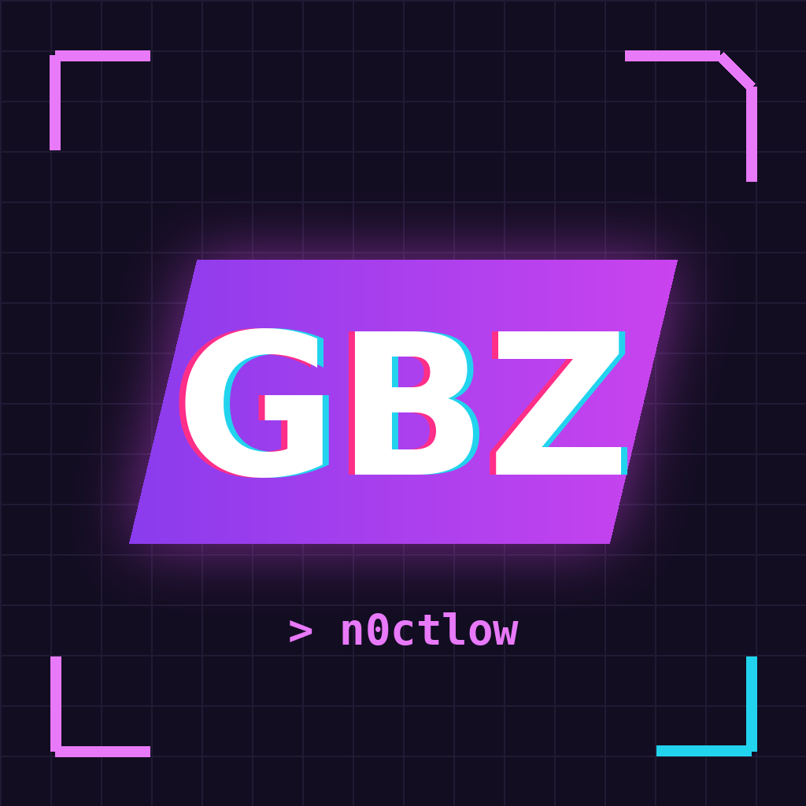

# OPTIMIZER GBZ

**Painel de otimização gamer para Windows 10 e 11, com visual Cyber HUD.**

`> by n0ctlow`

---

## O que ele faz

| Aba | Para quê |
|---|---|
| **Painel** | CPU, RAM, disco e ping ao vivo, gráfico da CPU e o botão **Modo Gamer** |
| **Modo Gamer** | Diagnóstico de travadinhas com nota de 0 a 100, ajustes de **input lag** e de **FPS** |
| **Internet e lag** | Teste de ping, jitter e perda; DNS mais rápido; ajustes de rede para jogos |
| **Música** | Player do Spotify com vinil girando, visualizador, cores da capa, modo festa e estatísticas da sessão |
| **Tela e cores** | Modos de cor (Gamer, Competitivo, Filme, Noite, Leitura): brilho, gama, temperatura e saturação |
| **Iluminação RGB** | Controle universal de LED usando o [OpenRGB](https://openrgb.org) |
| **Memória e processos** | Liberar RAM e ver o que está pesando |
| **Limpeza** | Temporários, cache do Windows Update, dumps, cache de navegadores e mais |
| **Ajustes do Windows** | Plano de energia, efeitos visuais, anúncios, pesquisa do Bing |
| **Inicialização** | Ligar e desligar o que abre junto com o Windows |
| **Manutenção** | SFC, DISM, saúde dos discos, ponto de restauração, atualizações via winget |

---

## Como usar

1. Baixe o ZIP em **[Releases](../../releases)** (ou em **Code → Download ZIP**).
2. Clique com o botão direito no ZIP e escolha **Extrair tudo**. Não abra direto de dentro do ZIP.
3. Abra **`Abrir Optimizer GBZ.bat`** e clique em **Sim** no pedido de administrador.
4. Na primeira vez, digite o seu **nick** (não tem senha, é só para o painel saber como te chamar). Dá para trocar depois no lápis ao lado do nome, no topo.

> **Antes de mexer nos ajustes**, clique em **Criar ponto de restauração** (aba Painel ou Manutenção).

### Requisitos
- Windows 10 ou 11 (64 bits)
- Windows PowerShell 5.1 (já vem no Windows)
- Permissão de administrador

### Deu erro?
Abra **`Abrir em modo diagnostico.bat`**. Uma janela preta vai mostrar o que aconteceu. Tire um print e abra uma [issue](../../issues).

---

## Segurança e transparência

O Optimizer GBZ é **um único arquivo de script aberto** (`Optimizer-GBZ.ps1`). Dá para ler tudo o que ele faz.

- **Não baixa nada sozinho.** Só abre um site ou o winget quando você clica no botão correspondente.
- **Não coleta nem envia dados.** As únicas conexões são o ping para `1.1.1.1` e `8.8.8.8` e o teste de DNS quando você pede. O nick fica só no seu PC.
- **Tudo é reversível.** Cada ajuste é um interruptor: desligou, voltou ao padrão do Windows.
- **A limpeza tem trava de segurança.** Pastas do sistema e do usuário nunca são apagadas, e atalhos de pasta nunca são seguidos.
- **As configurações ficam no seu PC**, no registro, em `HKCU\Software\OptimizerGBZ`.

### Por que pede administrador?
Limpar pastas do sistema, mudar o plano de energia, ajustar a rede e criar pontos de restauração exigem essa permissão no Windows.

### O antivírus ou o SmartScreen reclamou
Scripts baixados da internet que pedem administrador às vezes recebem aviso, mesmo sendo seguros. No SmartScreen, clique em **Mais informações → Executar assim mesmo**. Se quiser conferir, envie o arquivo para o [VirusTotal](https://www.virustotal.com).

---

## Música

Funciona com o **Spotify** e com qualquer player que apareça nos controles de mídia do Windows (YouTube no navegador, por exemplo). Não precisa de login.

- Disco de vinil girando atrás da capa e visualizador dançando enquanto toca
- **Cores da capa:** o player pega a cor do álbum
- **Modo festa:** visualizador arco-íris, borda piscando e confete a cada música
- **LED do PC na cor da capa** (com o OpenRGB instalado)
- Estatísticas da sessão e um terminal com frases zoeiras

> O status no Discord está em desenvolvimento e vai voltar numa próxima versão.

## Iluminação RGB

Usa o **[OpenRGB](https://openrgb.org)**, que é gratuito e de código aberto. Para RAM e algumas placas-mãe, também é preciso o **[PawnIO](https://pawnio.eu)**. Feche os programas da marca (Armoury Crate, iCUE, Mystic Light etc.) antes de usar.

---

## Limitações conhecidas

- A **saturação** da aba Tela e cores só fica ativa com o painel aberto (pode minimizar) e não funciona em jogos de **tela cheia exclusiva**. Para esses jogos, use a Vibração digital da NVIDIA ou a Saturação da AMD.
- Com **HDR** ou **Luz noturna** ligados, o Windows pode bloquear os ajustes de cor.
- **Liberar RAM** tem efeito temporário: o Windows volta a usar a memória livre como cache, e isso é normal.

---

## Créditos

- Criado por **n0ctlow (GBZ)**
- Iluminação RGB via [OpenRGB](https://openrgb.org)

## Licença

[MIT](LICENSE): pode usar, estudar e modificar, desde que mantenha os créditos.

> Este projeto é fornecido "como está", sem garantias. Use por sua conta e crie um ponto de restauração antes de aplicar ajustes.
